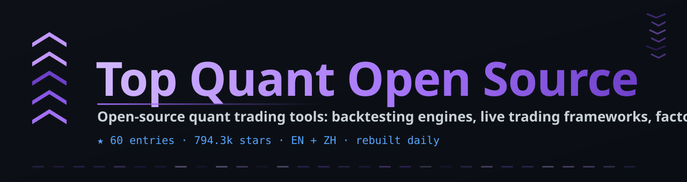

# 开源量化交易工具大全

<i>开源量化交易工具：回测引擎、实盘交易框架、因子研究、行情数据与组合优化库，按 GitHub Stars 排名</i>

  

  

[English](README.md) · **简体中文**

---

## 目录

- [🏆 精选 Top](#top-picks)
- [Live & Algorithmic Trading Frameworks](#sec-1) · 15
- [Backtesting Engines](#sec-2) · 15
- [Factor Research & ML for Finance](#sec-3) · 15
- [Market Data & Portfolio Libraries](#sec-4) · 15
- [📖 关于本列表](#about)

## 🏆 精选 Top

| # | 项目 | ⭐ Stars | 语言 | 更新 | 简介 |
|:-:|:--|--:|:-:|:-:|:--|
| 1 | [**openbq-org/OpenBB**](https://github.com/openbq-org/OpenBB) | 75.7k | Python | 2026-11-18 | Open Data Platform for analysts, quants and AI agents. |
| 2 | [**ZhuLinsen/daily_stock_analysis**](https://github.com/ZhuLinsen/daily_stock_analysis) | 73.8k | Python | 2026-11-23 | LLM 驱动的多市场股票智能分析系统：多源行情、实时新闻、决策看板与自动推送，支持零成本定时运行。 LLM-powered multi-market stock analysis system with multi-s… |
| 3 | [**freqtrade/freqtrade**](https://github.com/freqtrade/freqtrade) | 57.2k | Python | 2026-11-23 | Free, open source crypto trading bot |
| 4 | [**microsoft/qlib**](https://github.com/microsoft/qlib) | 50.5k | Python | 2026-11-04 | Qlib is an AI-oriented Quant investment platform that aims to use AI tech to empower Quant Research, from exp… |
| 5 | [**HKUDS/Vibe-Trading**](https://github.com/HKUDS/Vibe-Trading) | 38.7k | Python | 2026-11-22 | "Vibe-Trading: Your Personal Trading Agent" |

## Live & Algorithmic Trading Frameworks

| # | 项目 | ⭐ Stars | 语言 | 更新 | 简介 |
|:-:|:--|--:|:-:|:-:|:--|
| 1 | [**ZhuLinsen/daily_stock_analysis**](https://github.com/ZhuLinsen/daily_stock_analysis) | 73.8k | Python | 2026-11-23 | LLM 驱动的多市场股票智能分析系统：多源行情、实时新闻、决策看板与自动推送，支持零成本定时运行。 LLM-powered multi-market stock analysis system with multi-s… |
| 2 | [**freqtrade/freqtrade**](https://github.com/freqtrade/freqtrade) | 57.2k | Python | 2026-11-23 | Free, open source crypto trading bot |
| 3 | [**microsoft/qlib**](https://github.com/microsoft/qlib) | 50.5k | Python | 2026-11-04 | Qlib is an AI-oriented Quant investment platform that aims to use AI tech to empower Quant Research, from exp… |
| 4 | [**Fincept-Corporation/FinceptTerminal**](https://github.com/Fincept-Corporation/FinceptTerminal) | 34.1k | C++ | 2026-11-19 | FinceptTerminal is a modern finance application offering advanced market analytics, investment research, and… |
| 5 | [**QuantConnect/Lean**](https://github.com/QuantConnect/Lean) | 22.7k | C# | 2026-11-20 | Lean Algorithmic Trading Engine by QuantConnect (Python, C#) |
| 6 | [**quantopian/zipline**](https://github.com/quantopian/zipline) | 20.3k | Python | 2024-02-13 | Zipline, a Pythonic Algorithmic Trading Library |
| 7 | [**bbfamily/abu**](https://github.com/bbfamily/abu) | 19.2k | Python | 2026-10-16 | 阿布量化交易系统(股票，期权，期货，比特币，机器学习) 基于python的开源量化交易，量化投资架构 |
| 8 | [**AI4Finance-Foundation/FinRL**](https://github.com/AI4Finance-Foundation/FinRL) | 17.2k | Jupyter Notebook | 2026-11-18 | FinRL®: Financial Reinforcement Learning. 🔥 |
| 9 | [**je-suis-tm/quant-trading**](https://github.com/je-suis-tm/quant-trading) | 11.3k | Python | 2026-06-20 | Python quantitative trading strategies including VIX Calculator, Pattern Recognition, Commodity Trading Advis… |
| 10 | [**jesse-ai/jesse**](https://github.com/jesse-ai/jesse) | 8.8k | Python | 2026-11-23 | An advanced trading bot written in Python |

展开其余 5 项

| # | 项目 | ⭐ Stars | 语言 | 更新 | 简介 |
|:-:|:--|--:|:-:|:-:|:--|
| 11 | [**ranaroussi/quantstats**](https://github.com/ranaroussi/quantstats) | 7.9k | Python | 2026-11-02 | Portfolio analytics for quants, written in Python |
| 12 | [**charliedream1/ai_quant_trade**](https://github.com/charliedream1/ai_quant_trade) | 6.8k | Python | 2026-11-21 | Stock AI Trader: 1-stop platform for learning, sim & live trading. Covers: stock basics, strategies, LLMs, fa… |
| 13 | [**The-Swarm-Corporation/AutoHedge**](https://github.com/The-Swarm-Corporation/AutoHedge) | 6.7k | Python | 2026-05-11 | Build your autonomous hedge fund in minutes. AutoHedge harnesses the power of swarm intelligence and AI agent… |
| 14 | [**PyPortfolio/PyPortfolioOpt**](https://github.com/PyPortfolio/PyPortfolioOpt) | 6.2k | Jupyter Notebook | 2026-07-07 | Financial portfolio optimization in python, including classical efficient frontier, Black-Litterman, Hierarch… |
| 15 | [**Superalgos/Superalgos**](https://github.com/Superalgos/Superalgos) | 5.8k | JavaScript | 2026-11-14 | Free, open-source crypto trading bot, automated bitcoin / cryptocurrency trading software, algorithmic tradin… |

## Backtesting Engines

| # | 项目 | ⭐ Stars | 语言 | 更新 | 简介 |
|:-:|:--|--:|:-:|:-:|:--|
| 1 | [**HKUDS/Vibe-Trading**](https://github.com/HKUDS/Vibe-Trading) | 38.7k | Python | 2026-11-22 | "Vibe-Trading: Your Personal Trading Agent" |
| 2 | [**mementum/backtrader**](https://github.com/mementum/backtrader) | 23.8k | Python | 2024-08-19 | Python Backtesting library for trading strategies |
| 3 | [**hummingbot/hummingbot**](https://github.com/hummingbot/hummingbot) | 21.4k | Python | 2026-11-20 | Open source software that helps you create and deploy high-frequency crypto trading bots |
| 4 | [**UFund-Me/Qbot**](https://github.com/UFund-Me/Qbot) | 18.9k | Jupyter Notebook | 2026-03-11 | [🔥updating ...] AI 自动量化交易机器人(完全本地部署) AI-powered Quantitative Investment Research Platform. 📃 online docs: htt… |
| 5 | [**myhhub/stock**](https://github.com/myhhub/stock) | 15.3k | Python | 2026-04-02 | stock股票.获取股票数据,计算股票指标,筹码分布,识别股票形态,综合选股,选股策略,股票验证回测,股票自动交易,支持PC及移动设备。 |
| 6 | [**OpenByteInc/QuantDinger**](https://github.com/OpenByteInc/QuantDinger) | 13.9k | Python | 2026-11-22 | The most complete open-source, self-hosted Agentic Trading OS—AI research, Python strategies, factor discover… |
| 7 | [**StockSharp/StockSharp**](https://github.com/StockSharp/StockSharp) | 11.2k | C# | 2026-11-22 | Algorithmic trading and quantitative trading open source platform to develop trading robots (stock markets, f… |
| 8 | [**polakowo/vectorbt**](https://github.com/polakowo/vectorbt) | 9.9k | Python | 2026-11-11 | The research engine that gives you an unfair advantage. Run thousands of trading ideas before others finish o… |
| 9 | [**kernc/backtesting.py**](https://github.com/kernc/backtesting.py) | 9.3k | Python | 2026-08-05 | 🔎 📈 🐍 💰 Backtest trading strategies in Python. |
| 10 | [**Jakeschincariol/day-trader-skill**](https://github.com/Jakeschincariol/day-trader-skill) | 9.2k | Python | 2026-10-20 | 11 Claude skills for day trading: scan thousands of charts, track breaking news, time every entry and exit, a… |

展开其余 5 项

| # | 项目 | ⭐ Stars | 语言 | 更新 | 简介 |
|:-:|:--|--:|:-:|:-:|:--|
| 11 | [**shy3130/tick-stock-panel**](https://github.com/shy3130/tick-stock-panel) | 8.2k | Python | 2026-11-23 | TSP自托管、零运维的 A 股「自建策略 + 监控 + 回测」量化工作台 \| LLM能力驱使策略定制+个股分析+复盘 \| 自由接入第三方数据源与个性化扩展数据 |
| 12 | [**Drakkar-Software/OctoBot**](https://github.com/Drakkar-Software/OctoBot) | 7.0k | Python | 2026-11-21 | Free open source crypto trading bot to automate AI, Grid, DCA and TradingView strategies on Binance, Hyperliq… |
| 13 | [**ricequant/rqalpha**](https://github.com/ricequant/rqalpha) | 6.9k | Python | 2026-10-28 | A extendable, replaceable Python algorithmic backtest && trading framework supporting multiple securities |
| 14 | [**Mathieu2301/TradingView-API**](https://github.com/Mathieu2301/TradingView-API) | 5.9k | TypeScript | 2026-11-14 | 📈 Get real-time stocks from TradingView |
| 15 | [**nkaz001/hftbacktest**](https://github.com/nkaz001/hftbacktest) | 5.1k | Rust | 2025-12-23 | Free, open source, a high frequency trading and market making backtesting and trading bot, which accounts for… |

## Factor Research & ML for Finance

| # | 项目 | ⭐ Stars | 语言 | 更新 | 简介 |
|:-:|:--|--:|:-:|:-:|:--|
| 1 | [**openbq-org/OpenBB**](https://github.com/openbq-org/OpenBB) | 75.7k | Python | 2026-11-18 | Open Data Platform for analysts, quants and AI agents. |
| 2 | [**TA-Lib/ta-lib-python**](https://github.com/TA-Lib/ta-lib-python) | 12.4k | Cython | 2026-11-21 | Python wrapper for TA-Lib (http://ta-lib.org/). |
| 3 | [**simonlin1212/a-stock-data**](https://github.com/simonlin1212/a-stock-data) | 12.0k | Python | 2026-11-03 | A股全栈数据工具包：行情K线·当日逐笔·研报·信号·资金面·新闻·财务·公告·打板·ETF期权·舆情·宏观利率·期货大宗(含大商所日K)·事件驱动·可转债 \| 15层·87端点·34数据源·除iwencai外免Key… |
| 4 | [**lballabio/QuantLib**](https://github.com/lballabio/QuantLib) | 7.8k | C++ | 2026-11-20 | The QuantLib C++ library |
| 5 | [**google/tf-quant-finance**](https://github.com/google/tf-quant-finance) | 5.6k | Python | 2026-08-06 | High-performance TensorFlow library for quantitative finance. |
| 6 | [**JerBouma/FinanceToolkit**](https://github.com/JerBouma/FinanceToolkit) | 5.6k | Python | 2026-11-23 | Transparent and Efficient Financial Analysis |
| 7 | [**hudson-and-thames/mlfinlab**](https://github.com/hudson-and-thames/mlfinlab) | 5.0k | Python | 2023-10-02 | MlFinLab helps portfolio managers and traders who want to leverage the power of machine learning by providing… |
| 8 | [**skfolio/skfolio**](https://github.com/skfolio/skfolio) | 2.7k | Python | 2026-11-20 | Python library for portfolio optimization, factor model construction, and risk management built on scikit-lea… |
| 9 | [**Miasyster/QuantGPT**](https://github.com/Miasyster/QuantGPT) | 519 | Python | 2026-11-23 | Agent-driven alpha factory — LLM autonomously designs, backtests, and submits factors to WorldQuant BRAIN |
| 10 | [**CamusGIT/EvoQuant**](https://github.com/CamusGIT/EvoQuant) | 144 | Python | 2026-09-02 | EvoQuant is a self-evolving AI research agent specialized in quantitative investment research. It runs the fu… |

展开其余 5 项

| # | 项目 | ⭐ Stars | 语言 | 更新 | 简介 |
|:-:|:--|--:|:-:|:-:|:--|
| 11 | [**VernonOY/alpha-skills**](https://github.com/VernonOY/alpha-skills) | 126 | — | 2026-04-14 | Quantitative factor research skills for AI coding assistants |
| 12 | [**initial-d/ml-quant-trading**](https://github.com/initial-d/ml-quant-trading) | 113 | Python | 2026-11-23 | PyTorch ML quant research: 213 factors, bias correction, portfolio optimization, backtesting, and System-One/… |
| 13 | [**heranliu/AlphaResearchOS**](https://github.com/heranliu/AlphaResearchOS) | 112 | Python | 2026-10-09 | Agentic quant research workbench with CSV data inspection, local Codex and compatible APIs, predictive models… |
| 14 | [**mooyang-code/moox**](https://github.com/mooyang-code/moox) | 105 | Go | 2026-11-23 | 生产级分布式实时量化平台：行情采集、因子计算、策略决策、实盘交易、监控告警一体化，支持加密货币、A 股、港股、美股，AI Agent 一句话部署 |
| 15 | [**zhangsensen/etf-rotation-strategy**](https://github.com/zhangsensen/etf-rotation-strategy) | 104 | Python | 2026-10-05 | A-share ETF rotation research and backtesting platform with walk-forward, vectorized, and event-driven valida… |

## Market Data & Portfolio Libraries

| # | 项目 | ⭐ Stars | 语言 | 更新 | 简介 |
|:-:|:--|--:|:-:|:-:|:--|
| 1 | [**ranaroussi/yfinance**](https://github.com/ranaroussi/yfinance) | 26.0k | Python | 2026-11-22 | Download market data from Yahoo! Finance's API |
| 2 | [**akfamily/akshare**](https://github.com/akfamily/akshare) | 23.4k | Python | 2026-11-20 | AKShare is an elegant and simple financial data interface library for Python, built for human beings! 开源财经数据接… |
| 3 | [**waditu/tushare**](https://github.com/waditu/tushare) | 15.5k | Python | 2024-03-13 | TuShare is a utility for crawling historical data of China stocks |
| 4 | [**JerBouma/FinanceDatabase**](https://github.com/JerBouma/FinanceDatabase) | 9.7k | Python | 2026-11-22 | This is a database of 300.000+ symbols containing Equities, ETFs, Funds, Indices, Currencies, Cryptocurrencie… |
| 5 | [**1nchaos/adata**](https://github.com/1nchaos/adata) | 5.4k | Python | 2026-10-31 | 免费开源A股量化交易数据库； 专注A股，专注量化，向阳而生； 开放、纯净、持续、为Ai(爱)发电。为个人量化交易而生，保卫3000点，珍惜底部机会......【股票数据，股票行情数据，股票量化数据，股票交易数据，k线行… |
| 6 | [**RomelTorres/alpha_vantage**](https://github.com/RomelTorres/alpha_vantage) | 4.9k | Python | 2026-07-26 | A python wrapper for Alpha Vantage API for financial data. |
| 7 | [**dcajasn/Riskfolio-Lib**](https://github.com/dcajasn/Riskfolio-Lib) | 4.6k | C++ | 2026-11-04 | Portfolio Optimization in Python |
| 8 | [**Hithink-Tech-Org/Financial-API**](https://github.com/Hithink-Tech-Org/Financial-API) | 4.6k | TypeScript | 2026-11-12 | 同花顺官方 A股金融数据服务，提供股票实时行情、历史行情、财务报表、指数、板块、涨停等数据，适用于 AI Agent、量化研究和应用开发，支持 API、MCP、CLI 和 Python。Official Tonghua… |
| 9 | [**tradytics/eiten**](https://github.com/tradytics/eiten) | 3.3k | Python | 2022-07-30 | Statistical and Algorithmic Investing Strategies for Everyone |
| 10 | [**pydata/pandas-datareader**](https://github.com/pydata/pandas-datareader) | 3.3k | Python | 2026-07-21 | Extract data from a wide range of Internet sources into a pandas DataFrame. |

展开其余 5 项

| # | 项目 | ⭐ Stars | 语言 | 更新 | 简介 |
|:-:|:--|--:|:-:|:-:|:--|
| 11 | [**hello245m/free-stockdb**](https://github.com/hello245m/free-stockdb) | 3.2k | HTML | 2026-11-11 | 面向 A 股日K、分钟K与ETF分钟数据的本地量化引擎，集成增量同步、本地缓存、复权、批量查询、回测与指标计算。 |
| 12 | [**FinMind/FinMind**](https://github.com/FinMind/FinMind) | 2.9k | HTML | 2026-11-22 | Open Data, more than 50 financial data. 提供超過 50 個金融資料(台股為主)，每天更新 https://finmind.github.io/ |
| 13 | [**anandanand84/technicalindicators**](https://github.com/anandanand84/technicalindicators) | 2.5k | JavaScript | 2022-11-03 | A javascript technical indicators written in typescript with pattern recognition right in the browser |
| 14 | [**chengzuopeng/stock-sdk**](https://github.com/chengzuopeng/stock-sdk) | 2.0k | TypeScript | 2026-11-21 | 为前端设计的无需 Python、无需后端服务、零依赖的获取股票数据 JavaScript SDK。 |
| 15 | [**simonlin1212/global-stock-data**](https://github.com/simonlin1212/global-stock-data) | 1.9k | — | 2026-11-02 | 美股与全球市场数据工具包（给 AI 编程助手用）：官方源优先、零鉴权、标注合规级别 \| US & global market data for AI coding assistants — zero-auth, of… |

## 📖 关于本列表

本列表从 GitHub 自动采集，经过去重、链接检查，按 Stars 排名（Stars 相同时按最近更新排序），并定时自动刷新，数据始终保持最新。

---

自动生成 · 定时刷新 · 按 GitHub Stars 排名 · 2026-11-23

